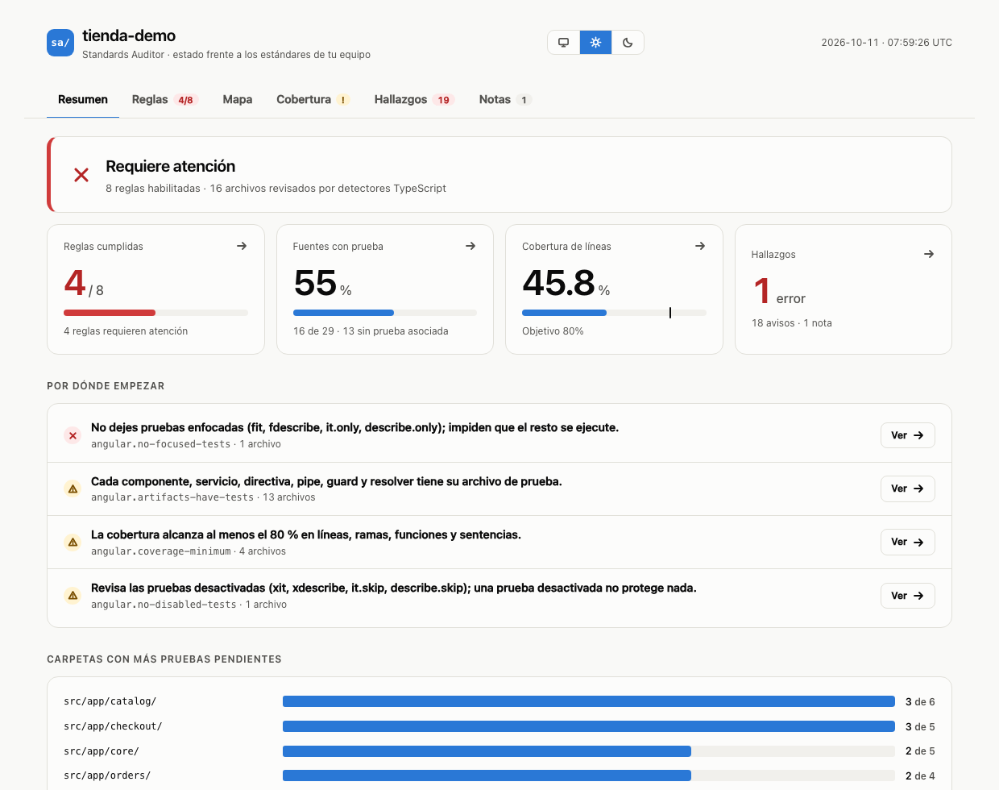
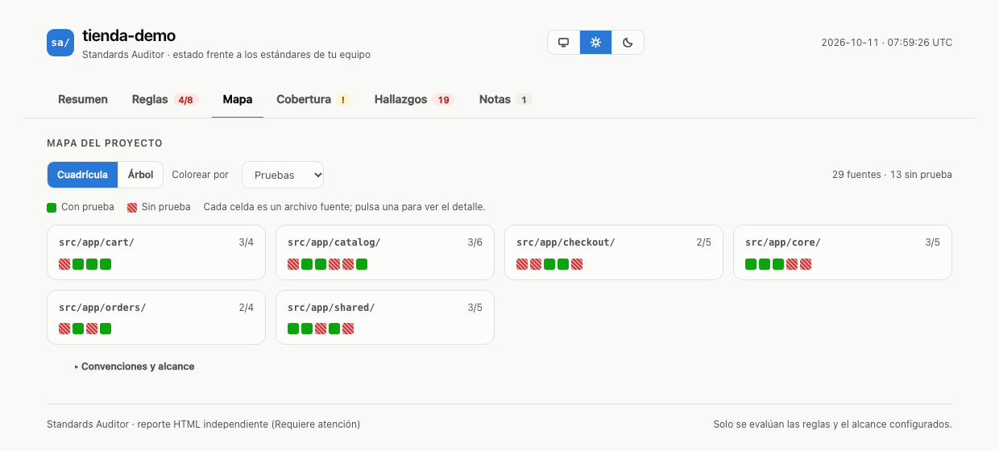

# Standards Auditor

**Descubre en segundos qué le falta de pruebas unitarias a un proyecto, qué archivo crear y cómo cumplir cada regla.**

<picture>
  <source media="(prefers-color-scheme: dark)" srcset="docs/img/resumen-oscuro.png">
  
</picture>

Cada equipo decide cuándo un proyecto «tiene sus pruebas». Standards Auditor lo comprueba leyendo tu código, sin ejecutarlo ni modificarlo, y lo muestra en la consola y en un reporte HTML pensado para desarrolladores. Está pensado para equipos con TypeScript (Angular, Vitest, Jest o Karma) y, sobre todo, para quien se incorpora y todavía no conoce el estándar.

**Estado:** `0.2.0-alpha.4` · Node.js 22 o superior · Linux, macOS y Windows · [Licencia MIT](LICENSE)

## ¿Para qué sirve?

- **Para el equipo.** Defines una vez, en un archivo versionado (`auditor.yaml`), qué se espera de las pruebas, y lo verificas en cada PR y en CI.
- **Para quien se incorpora.** El reporte no solo dice «falta algo»: indica el archivo exacto que hay que crear y explica cada regla («Cómo cumplirla»).
- **Para un proyecto que ya existe.** `suggest` propone por dónde empezar y un umbral que pasa hoy, para ir subiéndolo poco a poco sin bloquear a nadie.

## Cómo funciona

1. **Instala** el paquete de la [última versión](https://github.com/soporte605/standards-auditor/releases) (el `.tgz`, no el «Source code»). Todavía no está en npm.
2. **`init`** detecta tu proyecto (TypeScript, Angular, Vitest o Karma…) y crea `auditor.yaml` con los packs que encajan.
3. **`check`** audita y te dice qué falta.

```sh
npm install --save-dev /ruta/al/standards-auditor-0.2.0-alpha.4.tgz
npx standards-auditor init
npx standards-auditor check          # resumen en consola
npx standards-auditor check --open   # reporte visual en el navegador
```

`check` termina con código `1` si hay errores, así que sirve en CI y como hook de `pre-push` ([guía](docs/git-hooks.md)). Un resultado típico en consola:

```text
# salida abreviada de un proyecto de demostración
$ npx standards-auditor check --details
Resultado: 1 error · 18 advertencias · 8 reglas habilitadas
Salud: 4/8 reglas cumplidas
  ✖ [angular.no-focused-tests] No dejes pruebas enfocadas (fit, fdescribe, it.only…)
  ✖ [angular.artifacts-have-tests] Cada componente, servicio… tiene su archivo de prueba.
ERROR src/app/cart/cart.service.spec.ts:3:3 [angular.no-focused-tests] … (it.only)
AVISO src/app/checkout/shipping.service.ts [angular.artifacts-have-tests] … → crea src/app/checkout/shipping.service.spec.ts
```

## Qué revisa

| Regla                                 | La pregunta que responde                                           |
| ------------------------------------- | ------------------------------------------------------------------ |
| Hay pruebas unitarias                 | ¿El proyecto tiene alguna?                                         |
| Cada artefacto tiene la suya          | ¿Componentes, servicios, pipes y guards tienen su `.spec.ts`?      |
| Sin pruebas enfocadas ni desactivadas | ¿Quedó un `it.only`, `fit` o `xit` olvidado?                       |
| Cobertura mínima                      | ¿El reporte `json-summary` alcanza el umbral que acordó el equipo? |

Las reglas, las severidades y los umbrales los decide tu equipo. Hoy se analiza TypeScript/JavaScript.

## El reporte

Seis pestañas, cada una con un trabajo: **Resumen** (veredicto y por dónde empezar), **Reglas** (qué falla y cómo arreglarlo), **Mapa** (una celda por archivo), **Cobertura**, **Hallazgos** (listado filtrable) y **Notas**. Es un único archivo HTML que funciona sin internet, con tema claro, oscuro o el de tu sistema, y se adapta a móvil.



## Adoptarlo en un proyecto que ya existe

```sh
npx standards-auditor suggest          # qué packs encajan y qué encontrarían hoy
npx standards-auditor suggest --write  # añade a auditor.yaml los recomendados
```

`suggest` no cambia nada sin `--write`. Si, por ejemplo, el 66 % de tus servicios ya tiene prueba, propone `minimum: 66`: el CI pasa hoy y subes el umbral cuando el equipo avance. Más sobre cómo integrarlo: [Husky y CI](docs/git-hooks.md) y [packs compartidos por la empresa](docs/shared-packs.md).

## Ajustar las reglas de tu equipo

```yaml
# auditor.yaml
schema-version: 1
packs: [builtin:typescript-tests, builtin:testing, builtin:angular]
rules:
  testing.source-has-test: off # desactiva una regla
  angular.coverage-minimum: error # sube la severidad
  angular.artifacts-have-tests: # acota y ajusta (por ejemplo, en un monorepo)
    sources: ['apps/web/**/*.{component,service}.ts']
    minimum: 60
```

## Preguntas frecuentes

- **¿Ejecuta mis pruebas?** No. Lee el código y, si existe, un reporte de cobertura que tú generas. «Tiene prueba» significa que existe el archivo con el nombre esperado, no que pase.
- **Mi equipo nombra las pruebas distinto.** Ajusta `inventory.test-patterns` en `auditor.yaml`.
- **¿Funciona sin Angular?** Sí: con TypeScript activa `testing` y `typescript-tests`.
- **¿Y con otros lenguajes?** Por ahora los detectores analizan TypeScript/JavaScript.
- **¿Necesita internet o enviar mi código a algún sitio?** No. Todo ocurre en tu equipo.

## Más

[Guía completa](docs/guia-completa.md) · [Reglas de Angular](docs/angular.md) · [Referencia de uso](docs/usage.md) · [Contribuir](CONTRIBUTING.md) · [Publicar versiones](docs/releasing.md) · [Changelog](CHANGELOG.md) · [Seguridad](SECURITY.md)
